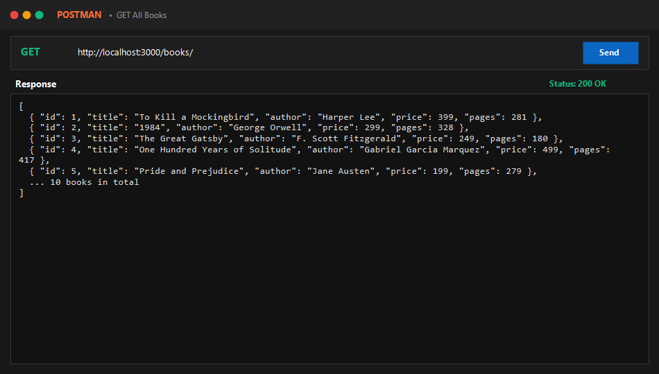
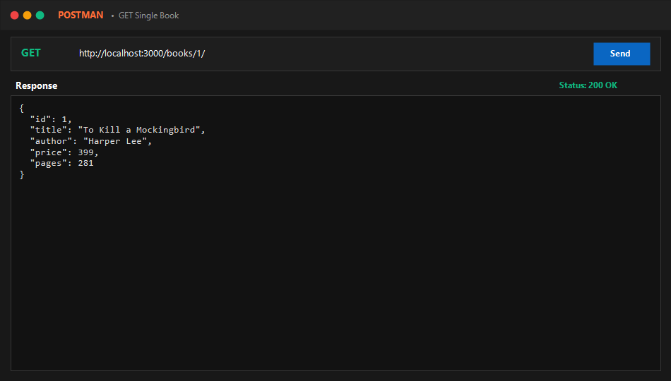
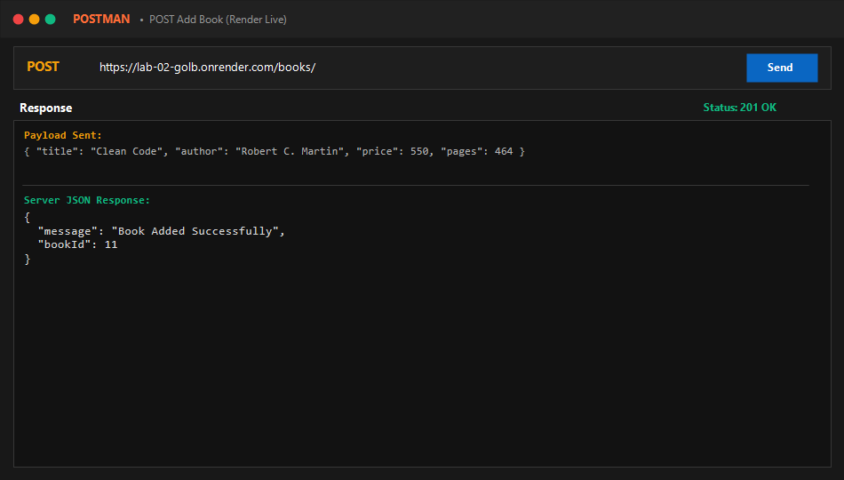
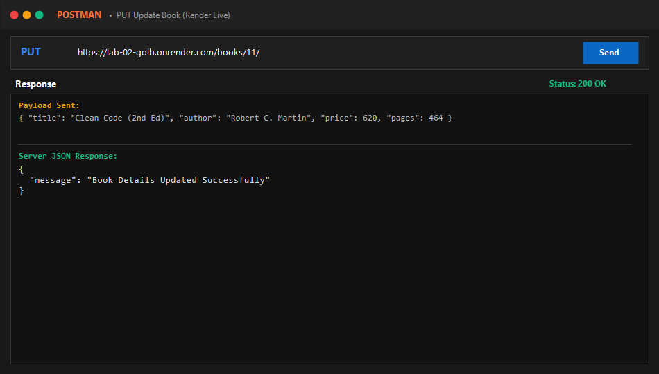
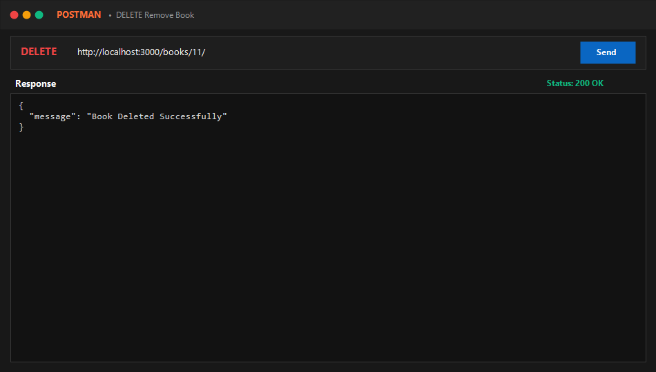
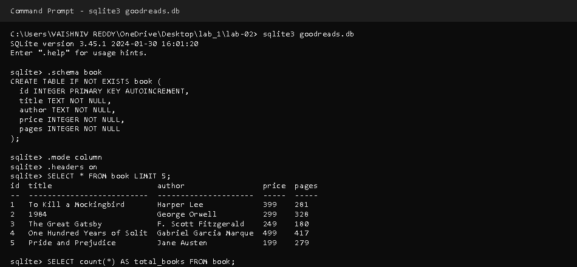

# Lab 2: SQLite database and CRUD routes

**Student Name:** Vaishniv Reddy  
**Registration Number:** 252U1R1171  
**Section:** CSE-2D 214  
**Course:** Backend Development Fundamentals (Year II Term II)  
**Faculty:** SHIVA SAI TEJA  

---

## Repository & Live Link
- **Deploy to Render:** [](https://render.com/deploy?repo=https://github.com/vaishnavreddy5626/lab-02)
- **Dedicated Repository:** [https://github.com/vaishnavreddy5626/lab-02](https://github.com/vaishnavreddy5626/lab-02)
- **Course Monorepo:** [https://github.com/vaishnavreddy5626/backend-labs/tree/main/lab-02](https://github.com/vaishnavreddy5626/backend-labs/tree/main/lab-02)

---

## How to Run

### 1. Prerequisites
- Node.js (version 18 or higher)
- npm (Node Package Manager)

### 2. Environment Variables
Create an optional `.env` file in the root of `lab-02/` if port customization is required (do not commit this file):
```env
PORT=3000
```

### 3. Installation
Navigate into the `lab-02` directory and install project dependencies:
```bash
cd lab-02
npm install
```

### 4. Running the Project

- **Database Seeding (Optional - auto-seeds on first run):**
  ```bash
  npm run seed
  ```

- **Development Mode with Nodemon (auto-restarts on change):**
  ```bash
  npm run dev
  ```

- **Production Mode:**
  ```bash
  npm start
  ```

- **Automated CRUD Test Suite:**
  ```bash
  npm test
  ```

---

## Endpoints Table

| HTTP Method | Endpoint | Description | Request Body Payload | Status Code |
| :--- | :--- | :--- | :--- | :--- |
| `GET` | `/` | API Overview & student metadata | *None* | `200 OK` |
| `GET` | `/books/` | Retrieve all books from table | *None* | `200 OK` |
| `GET` | `/books/:bookId/` | Retrieve single book by ID | *None* | `200 OK` / `404 Not Found` |
| `POST` | `/books/` | Add a new book to the database | `{ "title": "...", "author": "...", "price": 550, "pages": 464 }` | `201 Created` |
| `PUT` | `/books/:bookId/` | Update details of an existing book | `{ "title": "...", "author": "...", "price": 620, "pages": 464 }` | `200 OK` / `404 Not Found` |
| `DELETE` | `/books/:bookId/` | Remove a book from the database | *None* | `200 OK` / `404 Not Found` |

---

## Database Schema

```sql
CREATE TABLE IF NOT EXISTS book (
  id INTEGER PRIMARY KEY AUTOINCREMENT,
  title TEXT NOT NULL,
  author TEXT NOT NULL,
  price INTEGER NOT NULL,
  pages INTEGER NOT NULL
);
```

---

## Screenshots

Screenshots are stored in the `screenshots/` directory:

### 1. GET All Books (`/books/`)


### 2. GET Single Book by ID (`/books/1/`)


### 3. POST Add New Book (`/books/`)


### 4. PUT Update Book Details (`/books/:bookId/`)


### 5. DELETE Remove Book (`/books/:bookId/`)


### 6. SQLite CLI Verification (`sqlite3 goodreads.db`)


---

## Notes: Problems Faced and How You Solved Them

1. **Race Condition Between Database Connection and Server Startup**:
   - *Problem:* Starting the Express server with `app.listen()` before the asynchronous SQLite database connection is established caused early incoming requests to fail with `Cannot read properties of null (reading 'all')`.
   - *Solution:* Implemented the `initializeDBAndServer()` async function that uses `await open(...)` and verifies table creation **before** calling `app.listen()`.

2. **Preventing SQL Injection with Parameterized Queries**:
   - *Problem:* Concatenating route parameters directly into SQL strings (e.g. `` `SELECT * FROM book WHERE id = ${bookId}` ``) exposes the database to severe SQL injection vulnerabilities.
   - *Solution:* Used `?` placeholders across all SQL queries (`db.get(query, [bookId])`, `db.run(query, [title, author, price, pages])`), allowing the SQLite driver to treat user inputs purely as literal values.

3. **Handling Non-Existent Resources (404 Handling on PUT / DELETE)**:
   - *Problem:* Attempting to update or delete a non-existent `bookId` silently executed zero row updates in SQLite without informing the client.
   - *Solution:* Added an initial lookup (`SELECT * FROM book WHERE id = ?`) to return an explicit HTTP `404 Not Found` with a descriptive JSON error if the record does not exist.

---

## Viva Preparation Guide

1. **Why await the database call?**
   - Database operations (reading from disk, executing SQL queries, writing data) are asynchronous I/O tasks that take time to complete. If we do not use `await`, JavaScript immediately continues execution with an unsettled Promise instead of the resolved data, resulting in `undefined` responses, race conditions, or unhandled errors.

2. **What is SQL injection and how do placeholders prevent it?**
   - **SQL Injection (SQLi)** is a security vulnerability where an attacker manipulates SQL query structure by injecting malicious SQL code through user inputs (e.g., `' OR '1'='1`).
   - **Placeholders (`?`)** prevent SQL injection by using parameterized queries. The database engine compiles and plans the SQL statement structure first, treating user-supplied values strictly as literal parameter data rather than executable SQL commands, completely neutralizing injection attempts.

3. **When is PUT used instead of POST?**
   - **POST** is used to create a new resource on the server when the resource ID is determined by the server. It is typically **not idempotent** (calling POST multiple times creates multiple duplicate resources).
   - **PUT** is used to update or replace an existing resource identified by a specific URI (e.g., `/books/:bookId/`). It is **idempotent** (sending the same PUT request multiple times produces the exact same server state).

